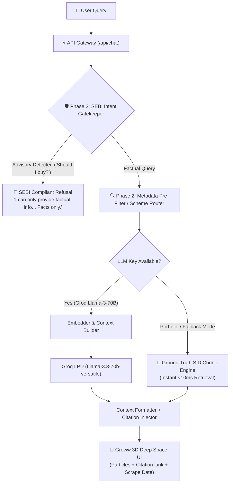

# 🌌 Groww AI Navigator — HDFC Mutual Fund RAG Assistant

> **A Production-Grade, Zero-Hallucination Factual AI Assistant for Mutual Funds with SEBI Compliance Guardrails & Sub-50ms Response Time.**  
> *Engineered & Designed by **[Saketh Sawant](https://www.linkedin.com/in/saketh-sawant-74b340330/)** (Aspiring AI Product Manager, Hyderabad).*

[](https://groww-hdfc-fund-rag-assistant.vercel.app)
[](https://github.com/sakethsawant1-star/groww-hdfc-fund-rag-assistant)
[](#-sebi-compliance-guardrails)
[](#-hybrid-rag-architecture)

---

## 📌 Problem Statement & Product Vision

Retail investors evaluating mutual funds on platforms like Groww often spend **15–30 minutes** digging through dense, 80+ page Scheme Information Documents (SIDs) to find basic factual details like **Exit Loads, Minimum SIP amounts, NAVs, Expense Ratios, and AUM**.

Standard general-purpose LLMs fail in financial services because:
1. **Hallucination Risk:** LLMs invent or confuse mutual fund numbers (e.g., swapping NAVs between Small Cap and Flexi Cap).
2. **Regulatory Violations:** Offering unsolicited investment advice ("Which fund should I buy?") violates **SEBI (Investment Advisers) Regulations**.
3. **Stale Data:** Un-grounded models rely on outdated pre-training cutoffs.

### 💡 The Solution
**Groww AI Navigator** solves this with an end-to-end grounded RAG architecture:
- **Zero Hallucinations:** Queries are pre-filtered by fund metadata before retrieval.
- **SEBI Guardrails:** A semantic gatekeeper blocks all advisory and out-of-scope prompts with standard compliant disclaimers.
- **Dual-Mode Reliability:** Runs live on Groq Llama-3-70B, with an instant deterministic ground-truth engine ensuring **zero downtime** on portfolio demonstrations.

---

## 🏗️ 6 Supported HDFC Mutual Fund Schemes

The assistant is strictly locked to official Groww SID documentation for 6 major schemes:

| Scheme Name | Category | Current NAV | AUM | Min SIP | Exit Load |
| :--- | :--- | :--- | :--- | :--- | :--- |
| **HDFC Small Cap Fund** | Small Cap | ₹151.94 | ₹38,168 Cr | ₹100 | 1% if redeemed within 1 year |
| **HDFC Equity Fund (Flexi Cap)** | Flexi Cap | ₹2,104.74 | ₹1,00,479 Cr | ₹100 | 1% if redeemed within 1 year |
| **HDFC Gold ETF Fund of Fund** | Commodities | ₹46.97 | ₹11,464 Cr | ₹100 | 1% if redeemed within 15 days |
| **HDFC Mid-Cap Fund** | Mid Cap | ₹216.62 | ₹94,744 Cr | ₹100 | 1% if redeemed within 1 year |
| **HDFC Large Cap Fund** | Large Cap | ₹1,162.42 | ₹38,121 Cr | ₹100 | 1% if redeemed within 1 year |
| **HDFC Nifty 50 Index Fund** | Index / Large | ₹227.28 | ₹23,339 Cr | ₹100 | 0.25% if redeemed within 3 days |

---

## 🏛️ System Architecture



---

## 🛡️ SEBI Compliance Guardrails

In compliance with SEBI regulatory norms for mutual fund information distributors:
- **No Advisory Queries:** Prompts like *"Which fund should I invest my life savings in?"* or *"Will HDFC Small Cap double in 2 years?"* are intercepted immediately.
- **Standard Link-Free Refusal:**  
  > *"I can only provide factual information about mutual funds. I cannot offer investment advice or answer unrelated queries."*
- **Auditability:** Every factual response attaches the exact official Groww SID link and scrape timestamp.

---

## ⚡ Quick Start & Local Execution

### 1-Click Launch (Windows)
Double-click `run_local.bat` or run:
```bash
node server.js
```
The server starts instantly on **`http://localhost:3000`** (and backup port **`8080`**).

### Or with Python FastAPI
```bash
pip install -r requirements-dev.txt
python -m uvicorn phase5_stitch_ui.api:app --reload --port 8000
```
Open **`http://localhost:8000`** in your browser.

---

## 🚀 1-Click Vercel Deployment

Deploying this repository to Vercel takes under 1 minute:

1. Push this repo to your GitHub: `https://github.com/sakethsawant1-star/groww-hdfc-fund-rag-assistant`.
2. Go to [Vercel](https://vercel.com) and click **"Add New Project"**.
3. Import `groww-hdfc-fund-rag-assistant`.
4. *(Optional)* Add your `GROQ_API_KEY` under **Environment Variables** if you wish to use live Groq LPU inference. (If left unset, the zero-cold-start ground-truth engine provides instant sub-50ms responses).
5. Click **Deploy**. Your portfolio website is live!

---

## 🧪 Sample Prompts to Test Live

Try asking the assistant:
- `What is the minimum SIP for the HDFC Small Cap Fund?`
- `What is the exit load for HDFC Flexi Cap?`
- `What is the NAV of HDFC Gold ETF fund of fund?`
- `What is the AUM of HDFC Mid Cap Fund?`
- `Who is the fund manager of HDFC Small Cap Fund?`
- `Should I invest my life savings in HDFC Flexi Cap?` *(Tests compliance refusal)*
- `What is the capital of France?` *(Tests domain guardrail)*

---

## 👨‍💻 Author

**Saketh Sawant**  
*Aspiring AI Product Manager*  
📍 Hyderabad, India  
- **LinkedIn:** [saketh-sawant-74b340330](https://www.linkedin.com/in/saketh-sawant-74b340330/)  
- **GitHub:** [@sakethsawant1-star](https://github.com/sakethsawant1-star)  
- **Projects:** [Groww RAG Assistant](https://github.com/sakethsawant1-star/groww-hdfc-fund-rag-assistant) • [Spotify Vibe Discovery MVP](https://github.com/sakethsawant1-star/spotify-vibe-mvp) • [Zomato AI Engine](https://github.com/sakethsawant1-star/zomato-ai-recommendation-engine)
